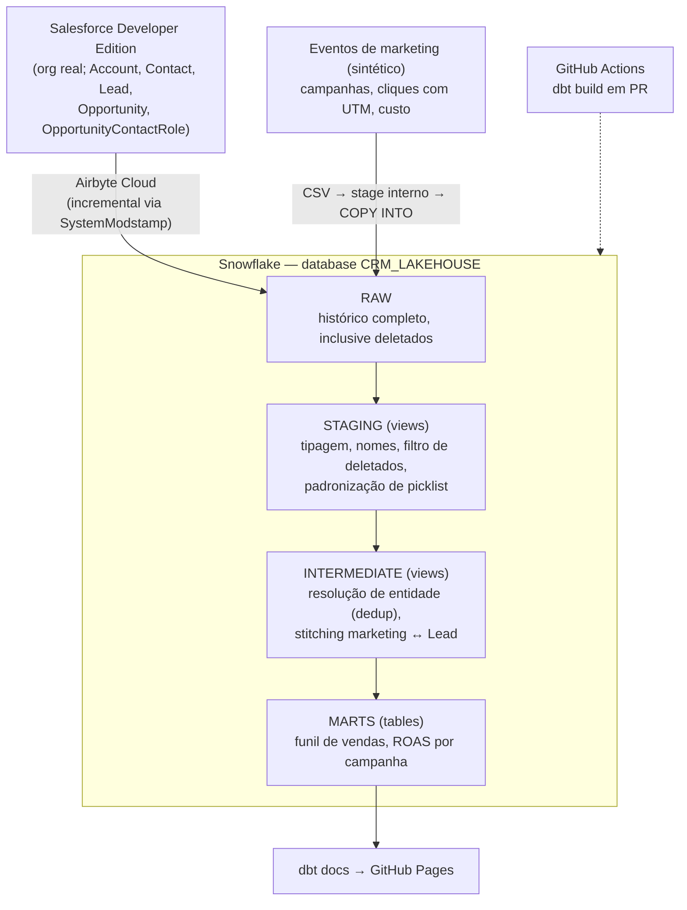

# crm-lakehouse-decisions

[](https://github.com/fabricioespel-bit/crm-lakehouse-decisions/actions/workflows/dbt-ci.yml)
[](https://fabricioespel-bit.github.io/crm-lakehouse-decisions/)

**Documentação do projeto dbt (models, colunas, testes e linhagem):** https://fabricioespel-bit.github.io/crm-lakehouse-decisions/

Pipeline analítico **Salesforce + marketing → Snowflake → dbt Core**, construído para resolver dois
problemas comuns em empresas que geram leads via marketing e fecham venda via CRM:

1. **Qualidade de dado no CRM** — duplicidade de contas, picklists inconsistentes, campos mal
   preenchidos, datas ilógicas.
2. **Atribuição de marketing (marketing ↔ CRM)** — ligar o clique na campanha ao Lead e à venda,
   sabendo que o rastreamento se perde no caminho, para chegar a ROAS por campanha.

O sufixo `-decisions` é intencional: o repositório documenta **por que** cada escolha foi feita, não
só o código. O registro completo e cronológico (incluindo obstáculos reais e como foram resolvidos)
está em [`PLANO.md`](PLANO.md).

> Todos os dados são **sintéticos** — gerados por script, com sujeira e desalinhamento injetados de
> propósito e taxas configuráveis. Detalhes em [`data/GENERATED_DATA.md`](data/GENERATED_DATA.md).

---

## Arquitetura



| Camada | Responsabilidade | Status |
|---|---|---|
| **RAW** | Cópia fiel das fontes (8 tabelas) | ✅ |
| **STAGING** | 1:1 com a fonte: tipos, snake_case, `not ISDELETED`, de-para de picklist | ✅ 8 models |
| **INTERMEDIATE** | Regras de negócio: dedup de Accounts, stitching marketing ↔ Lead | ✅ dedup + stitching (4 models) |
| **MARTS** | Funil (win rate, ciclo), ROAS com atribuição explícita | ✅ atribuição first/last/linear, CPL/ROAS por campanha, funil por origem |
| **CI/CD + docs** | GitHub Actions + `dbt docs` publicado | ✅ CI em PR (schemas isolados por PR) + [docs publicados](https://fabricioespel-bit.github.io/crm-lakehouse-decisions/) |

Hoje: **10 models, 1 seed, 8 sources, 69 testes de dados** (genéricos + singulares), todos passando
(alguns em `warn` por design — ver abaixo).

---

## Stack

| Ferramenta | Papel | Por quê |
|---|---|---|
| **Salesforce Developer Edition** | Fonte CRM | Org real e gratuita: extração via API de verdade, com as particularidades reais (auth, campos de auditoria, lixeira) em vez de um CSV do Kaggle |
| **Python** (`simple-salesforce`, `Faker`) | Geração dos dados sintéticos | Script versionado documenta como o dado foi produzido; seed fixa, reprodutível |
| **Airbyte Cloud** | Ingestão Salesforce → Snowflake | Conector gerenciado com OAuth; self-hosted descartado (Docker não roda na máquina de desenvolvimento) |
| **Snowflake** | Data warehouse | Separação storage/compute, key-pair auth, resource monitor para governança de custo |
| **dbt Core** (`dbt-snowflake` 1.12) | Transformação, testes, documentação | CLI versionado no Git, CI próprio em vez do CI embutido do dbt Cloud |
| **Snowflake CLI** (`snow`) / **Salesforce CLI** (`sf`) | Operação e validação | Conferência de contagens e qualidade por SQL/SOQL, não só pela UI |
| **GitHub Actions** | CI/CD (planejado) | `dbt build` em todo PR que toca os models |

---

## Decisões de engenharia

### Ingestão
- **Airbyte para o Salesforce, `COPY INTO` para o marketing.** O Salesforce é uma fonte real, então
  faz sentido um conector real. A fonte de marketing é sintética desde a origem — simular um conector
  seria teatro; o script gera CSV e a carga é via stage interno + `COPY INTO`.
- **O RAW guarda tudo, inclusive deletados.** O Airbyte usa `queryAll` e traz registros da lixeira do
  Salesforce (90 Accounts no RAW vs. 71 ativas). Em vez de "corrigir" isso na ingestão, o RAW mantém o
  histórico e o **staging filtra `not ISDELETED`** — estado vivo só a partir do staging.
- **Fonte de marketing modela tracking de primeira parte** (tipo GA4/GTM), não a API agregada de uma
  plataforma de anúncio. Cada clique tem um `visitor_id` (cookie anônimo) e a jornada pode cruzar
  várias campanhas; o envio de formulário liga a jornada ao Lead pelo e-mail. No Salesforce chega só o
  UTM do último toque, e só em ~65% dos casos (ad blocker, cookie limpo, troca de dispositivo).
  A primeira versão da fonte (um clique por Lead) foi refeita antes da 2b por não permitir
  atribuição multi-toque — ver `PLANO.md`.

### Segurança e acesso
- **Um usuário de serviço por ferramenta**, com role de menor privilégio: `AIRBYTE_ROLE` (escrita só
  em `RAW`) e `DBT_ROLE` (leitura em `RAW`, ownership em `STAGING`/`INTERMEDIATE`/`MARTS`).
- **Key-pair RSA para toda autenticação programática** (CLI, Airbyte, dbt, CI), com chaves fora do
  repositório. A conta foi criada via Google SSO, então não existe senha; e o Snowflake não oferece a
  federação OIDC que usei no Azure em outro projeto — é uma diferença de plataforma, assumida
  conscientemente.
- `profiles.yml` do dbt fica em `~/.dbt/`, fora do repo.

### Modelagem (dbt)
- **Staging não muda granularidade.** `stg_accounts` continua com 71 linhas (1:1 com a fonte).
  Resolução de entidade é regra de negócio e vive na intermediate.
- **Dedup de Accounts na intermediate, via tabela de mapeamento.** `int_account_id_mapping` liga toda
  Account (inclusive as duplicadas) à sua mestre; `int_accounts` tem só as mestres (65). Apagar as
  duplicatas deixaria Contacts e Opportunities órfãos — o mapping permite reapontá-los.
  - Chave de dedup: **nome normalizado + telefone + site**. Nome sozinho gerou 14 grupos falsos
    (empresas diferentes com o mesmo sobrenome); a chave composta chegou exatamente aos 6 pares
    esperados. Critério de sobrevivência: registro mais antigo.
- **De-para de picklist via seed**, não `CASE WHEN`. `industry_mapping.csv` é versionado e mantível
  sem tocar no SQL; `coalesce(padronizado, original)` faz valor novo passar visível (e o
  `accepted_values` disparar) em vez de virar nulo silenciosamente. O valor original fica em
  `industry_raw` para auditoria.
- **`generate_schema_name` sobrescrito** para usar o schema da pasta diretamente
  (`staging`, `intermediate`, `marts`) em vez de concatenar com o schema do profile — o comportamento
  padrão é pensado para vários devs compartilhando uma conta, o que não se aplica aqui.
- **Staging → views; marts → tables.** Observado na prática: quando um teste falha no `dbt build`, o
  model já foi criado e o downstream é pulado — mas uma *view* pulada continua lendo o upstream
  quebrado. Materializar marts como tabela preserva a última versão boa.
- **Tipos com intenção:** `AMOUNT` chega como `FLOAT` do Airbyte e vira `number(18, 2)` (dinheiro em
  ponto flutuante acumula erro em somas).
- **Relacionamentos apontam staging → staging**, nunca staging → intermediate, para respeitar o fluxo
  do DAG e não acusar órfãos falsos.
- **Incremental só onde é seguro.** `stg_marketing_click_events` é incremental (merge por `click_id`,
  reprocessa os últimos 3 dias para evento atrasado — testado com cliques fictícios no RAW). O
  `int_marketing_touches`, que parece o candidato óbvio, continua view: uma conversão nova reclassifica
  cliques antigos, e um incremental por janela de data os deixaria errados em silêncio.
- **CI isolado por PR.** Cada PR roda `dbt build` completo em schemas próprios (`CI_PR<n>_*`, via
  prefixo no `generate_schema_name` só no target `ci`), lendo o `RAW` real, e os schemas são apagados
  no fim mesmo se o build falhar. O CI autentica com usuário e role dedicados (`DBT_CI_USER` /
  `DBT_CI_ROLE`, key-pair própria) que não têm escrita nos schemas de verdade — um secret vazado não
  alcança os dados publicados.

### Qualidade de dado: testar, não esconder
A sujeira é proposital e cada caso tem um tratamento explícito:

| Problema injetado | Onde aparece | Tratamento |
|---|---|---|
| Accounts duplicadas (~9%) | `stg_accounts` | Dedup na intermediate + teste singular de contagem |
| `Industry` inconsistente (`Tech`, `Health Care`…) | `stg_accounts` | Seed de de-para + `accepted_values` como alarme |
| `LeadSource` nulo ou `Other` (~22%) | `stg_leads` | `not_null` + `accepted_values` com **`severity: warn`** — dado sujo esperado, não deve travar o pipeline |
| Lead `Closed - Converted` sem conversão real (13 de 33) | `stg_leads` | Teste singular (`warn`); 8 deles recuperados pelo e-mail do Contact (`contact_match`) |
| Opportunity aberta antes da aquisição do Lead (2) | `int_lead_opportunities` | Teste singular (`warn`); fica fora do crédito de receita do marketing |
| `CloseDate` < `CreatedDate` (~5% das fechadas) | `stg_opportunities` | Teste singular (`warn`) |
| Opportunity sem Contact Role (39 de 200) | ausência de linha | Visível como `primary_contact_id` nulo; tratado nos marts |
| UTM não propagado ao Lead (~35%) | `stg_leads` | Jornada por e-mail recupera parte: match 71,2% vs. 47,2% só com UTM; teste `warn` abaixo de 60% |
| E-mail do formulário com caixa/espaço diferente do CRM (~10%) | `stg_marketing_form_submissions` | `lower(trim())` no staging, `email_raw` mantido para auditoria |
| Troca de dispositivo, cliques pós-conversão, cliques da plataforma > rastreados | fonte de marketing | `touch_phase` na 2b: só toques antes do envio e dentro de 90 dias contam |

**Princípio:** a atribuição de marketing será **explícita e honesta sobre o que não resolve** — a
camada de stitching expõe a taxa de match como métrica de qualidade, em vez de fingir atribuição
completa.

### Custo
- Após o trial, o projeto seguiu em **Snowflake On-Demand** (sem mensalidade, cobrança por segundo de
  compute) com **resource monitor** (`credit_quota = 5`/mês, notifica em 80%, suspende em 100%) e
  `AUTO_SUSPEND = 60`. Pegadinha registrada: criar o monitor não protege nada até associá-lo ao
  warehouse com `alter warehouse ... set resource_monitor`.
- Antes de o trial vencer, o RAW foi exportado (JSON gzip + DDL) para fora do Snowflake — Parquet
  falhou porque o Snowflake não descarrega `TIMESTAMP_TZ` para Parquet.

---

## Lições que valeram o projeto

- **Testes de integridade passando não garantem resultado certo.** Uma regex com `\s` em string de
  aspas simples no Snowflake perdeu a barra (vira escape da string) e o dedup parou de agrupar dois
  pares — com **todos** os testes de `unique`/`not_null`/`relationships` verdes. Só a conferência
  contra a contagem conhecida pegou. Virou um teste singular, e a falha foi reproduzida para provar
  que ele funciona.
- **Nome não identifica empresa.** O primeiro critério de dedup encontrou 14 "duplicatas" — eram
  empresas diferentes com nomes iguais. *Entity resolution* precisa de chave composta.
- **Conferir o cabeçalho do dbt.** Um YAML não salvo fez o `build` rodar só as views, com
  `PASS=4` e nenhum erro. O "Found N data tests" denunciou a ausência.
- **Partial parsing pode deixar testes órfãos** depois de renomear um model; `--no-partial-parse`
  resolve.

Lista completa, com datas e comandos, no [`PLANO.md`](PLANO.md) (seções 5 e 7).

---

## Estrutura do repositório

```
├── PLANO.md                    # plano vivo: decisões, log de progresso, obstáculos
├── data/                       # CSVs da fonte de marketing + GENERATED_DATA.md
├── scripts/
│   ├── generate_sample_data.py       # popula o Salesforce (com sujeira configurável)
│   ├── generate_marketing_events.py     # v1 (histórico): um clique por Lead, grava UTM no Lead
│   ├── generate_marketing_events_v2.py  # jornadas multi-toque, envios de formulário, custo diário
│   └── generate_lead_conversions.py     # elo Lead → Opportunity (patch no RAW, simula sync pós-conversão)
├── dbt/
│   ├── models/staging/         # 9 models + sources e testes em YAML
│   ├── models/intermediate/    # dedup de Accounts + stitching (conversões, toques, jornadas, atribuição, Lead → Opportunity)
│   ├── models/marts/           # atribuição Lead × campanha, CPL/ROAS por campanha, Opportunities e funil por origem
│   ├── seeds/staging/          # industry_mapping.csv
│   ├── tests/                  # testes singulares
│   └── macros/                 # generate_schema_name
└── docs/img/                   # prints da configuração do Airbyte
```

## Como rodar

Pré-requisitos: conta Snowflake com os schemas `RAW`/`STAGING`/`INTERMEDIATE`/`MARTS`, usuário de
serviço do dbt com key-pair, e `~/.dbt/profiles.yml` com o profile `crm_lakehouse`.

```bash
python -m venv venv && source venv/bin/activate
pip install -r requirements.txt

cd dbt
dbt debug          # valida conexão
dbt build          # seeds + models + testes, na ordem do DAG
dbt docs generate && dbt docs serve
```

---

## Próximos passos

- **Histórico de estágios:** extrair `OpportunityHistory` para medir conversão entre estágios — hoje o
  funil só tem o estágio atual (win rate sobre as fechadas, ciclo e pipeline por origem).
- **Operação:** proteção da `main` exigindo o check `dbt-build`; `--full-refresh` agendado do model
  incremental; `dbt source freshness` a partir de `_AIRBYTE_EXTRACTED_AT`.
